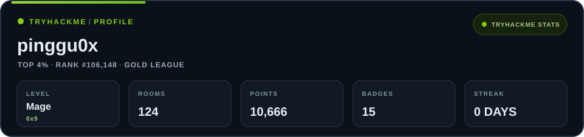

  

<h1 align="center">Gabriel Zantua</h1>

<strong>Linux systems. Security labs. Documented work.</strong>

I'm a BSIT student who learns through practical challenges and documents what I discover.

  

---

## Areas I'm exploring

- Linux systems and configuration
- Cybersecurity labs and CTFs
- Computer networking

## Tools and languages

**Systems and tools:** `Linux` · `Bash` · `Git` · `Vim`

**Programming and web:** `Java` · `JavaScript` · `Python` · `HTML` · `CSS` · `Markdown`

## TryHackMe

  

  

